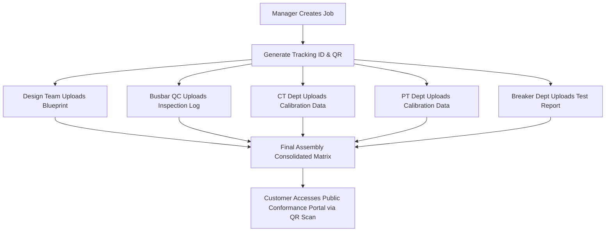

# Megawin QMS - Quality Management System

[](https://www.php.net/)
[](https://www.mysql.com/)
[](https://getbootstrap.com/)
[](#)

An enterprise-grade, lightweight Quality Management System (QMS) developed for **Megawin Switch Gear Pvt Ltd** to streamline quality control inspections across incoming, in-process, assembly, and dispatch stages using a department-wise document flow.

---

## 🌟 Core System Modules & Features

### 1. Job ID Creation & QR Code Generation
Managers can register manufacturing jobs with custom references, assigned engineers, priorities, and generate a secure public tracking QR token.

### 2. Isolated Department Workspaces
Company users can upload, view, and delete verification inspection reports across dynamically managed departmental stages. When department users log in, they are immediately routed to an isolated, customized workspace where they can strictly view and edit jobs relevant to their department.

### 3. Incoming QC Document Hierarchy
The Incoming QC department utilizes a hierarchical filing system based on dynamically managed dropdown options. IQC Users can independently define Companies, Products, and Years directly from their sidebar, maintaining an organized matrix of external vendor components.
A unified internal dashboard compiling and tracking the real-time status (Available/Pending) and download links for all required documents across every job.

### 4. Public Conformance Portal
Allows customers or administrators to scan panel QR codes and access a secure, responsive, standalone portal displaying stage-wise inspection document download links.

---

## 🔄 Quality Inspection Workflow



---

## 📂 Directory Structure

```
/app
  /Config       - Database and base config variables
  /Controllers  - Request controllers (JobController, DocumentController, etc.)
  /Helpers      - Routing, Security, and Session utilities
  /Models       - Relational models extending BaseModel
  /Routes       - Registered endpoint mappings (web.php)
  /Services     - DB connections and specific calculation services
  /Views        - View templates (PHP view scripts)
/database
  - schema.sql  - MySQL database schemas and seeders
/public
  /assets       - Custom CSS and JS assets
  - index.php   - Front controller & autoloader entrypoint
```

---

## 🛠️ Technology Stack
* **Backend:** PHP 8.3 (Custom OOP & MVC Architecture)
* **Database:** MySQL 8
* **Frontend:** Bootstrap 5, ES6 Javascript, JQuery, Custom Corporate CSS
* **Design System:** Deep Navy and Slate Grey, enterprise-grade sharp borders and responsive data tables.
* **Libraries:** Chart.js, SweetAlert2, FontAwesome, QR Code API

---

## 🚀 Getting Started

### 1. Database Configuration
1. Initialize the MySQL database schema and default seeds from [database/schema.sql](file:///d:/Bala/laragon/www/Projects%20All/per/mad/database/schema.sql).
2. Configure credentials inside [app/Config/database.php](file:///d:/Bala/laragon/www/Projects%20All/per/mad/app/Config/database.php).

### 2. Web Server Configuration
1. Point your Apache Virtual Host document root folder directly to the `/public` directory:
   ```apache
   DocumentRoot "D:/Bala/laragon/www/Projects All/per/mad/public"
   ```
2. Enable `mod_rewrite` in Apache to support clean URLs.

### 3. Log In
* **URL:** Navigate to `http://localhost/login`
* **Default Credentials:**
  * **Username:** `admin`
  * **Password:** `admin123`
### Default Roles and Credentials

| Role | Username | Password | Access Level |
|------|----------|----------|--------------|
| Admin (Owner) | `admin` | `admin123` | Can view ALL departments, but strictly Read-Only (No add/edit/delete buttons). |
| Final Assembly | `final_assembly_user` | `user123` | Can view ALL departments. Full CRUD access in Final Assembly; Read-Only elsewhere. |
| Design | `design_user` | `user123` | Sidebar ONLY shows Design. Full edit access to Design. |
| Busbar | `busbar_user` | `user123` | Sidebar ONLY shows Busbar. Full edit access to Busbar. |
| PT | `pt_user` | `user123` | Sidebar ONLY shows PT. Full edit access to PT. |
| CT | `ct_user` | `user123` | Sidebar ONLY shows CT. Full edit access to CT. |
| Breaker | `breaker_user` | `user123` | Sidebar ONLY shows Breaker. Full edit access to Breaker. |
| Incoming QC | `iqc_user` | `user123` | Sidebar ONLY shows Incoming QC. Full edit access to IQC. |